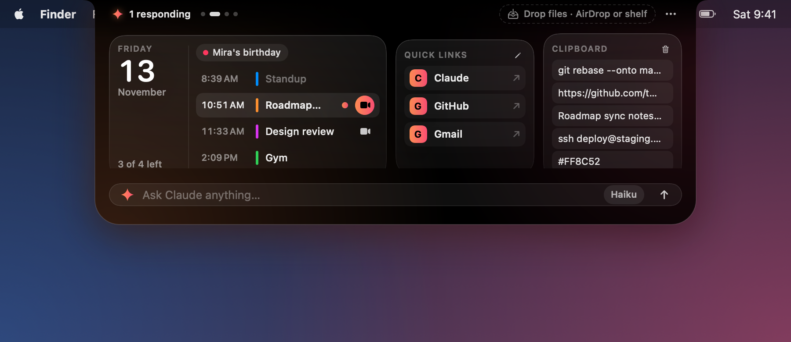
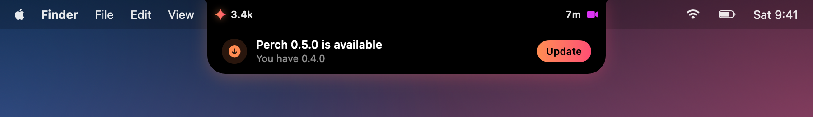

<p align="center"></p>

<h1 align="center">Perch</h1>

<p align="center"><b>Your MacBook's notch, put to work.</b><br>
Claude Code, music, files, your day and more, one hover away.</p>

<p align="center"><a href="docs/media/perch.mp4"></a><br>
<sub>▶ <a href="docs/media/perch.mp4">Watch with sound</a></sub></p>

## Get it

Open **Terminal**, paste this, press Return. That's all.

```bash
curl -fsSL https://raw.githubusercontent.com/tanmayhc7/perch/main/install.sh | bash
```

Free · open source · macOS 14+ · Apple Silicon and Intel · no Dock icon, just point at the notch

---

## What's inside

<table>
<tr>
<td align="center" width="50%"><br><b>Claude Code at a glance</b><br><sub>Tokens, cost, burn rate, budget left and the model in use. The notch glows while Claude works.</sub></td>
<td align="center" width="50%"><br><b>Ask Claude</b><br><sub>Type a question, get the answer, never leave your app.</sub></td>
</tr>
<tr>
<td align="center"><br><b>Alerts that slide out</b><br><sub>At 80% and 100% of your budget, and when a session finishes.</sub></td>
<td align="center"><br><b>Spotify and Apple Music</b><br><sub>Swipe between them with two fingers.</sub></td>
</tr>
<tr>
<td align="center"><br><b>Drop files</b><br><sub>AirDrop them, or park them on the shelf for later.</sub></td>
<td align="center"><br><b>A shelf for files</b><br><sub>Drag them back out into any app.</sub></td>
</tr>
<tr>
<td align="center" colspan="2"><br><b>Focus timer with its own music</b><br><sub>25, 50 or 5 minutes. Play a file or a YouTube link while it runs (ad-free with Brave), and optionally turn on Do Not Disturb.</sub></td>
</tr>
</table>

## The Nest: more slides, your widgets

**Swipe sideways with two fingers** to move to the next slide. Pick what goes on them under **⋯ → Nest**. Three widgets
fit on a slide; switch on more and **a new slide appears by itself**.

<p align="center"></p>
<p align="center"></p>
<p align="center"></p>

<table>
<tr>
<td align="center">📅<br><b>Today's calendar</b><br><sub>Google and Apple together, Join buttons</sub></td>
<td align="center">🔗<br><b>Quick links</b><br><sub>Four sites, one click</sub></td>
<td align="center">📋<br><b>Clipboard history</b><br><sub>The last ten things you copied</sub></td>
<td align="center">🐙<br><b>GitHub</b><br><sub>PRs to review, and your checks</sub></td>
</tr>
<tr>
<td align="center">📝<br><b>Scratchpad</b><br><sub>A note that saves itself</sub></td>
<td align="center">📊<br><b>System glance</b><br><sub>Battery, CPU, memory, AirPods</sub></td>
<td align="center">⛅<br><b>Weather</b><br><sub>Any city you type in</sub></td>
<td align="center">🔊<br><b>Volume & brightness</b><br><sub>Two sliders</sub></td>
</tr>
</table>

## Make it yours

<table>
<tr>
<td align="center"></td>
<td align="center"></td>
<td align="center"></td>
</tr>
<tr>
<td align="center" colspan="3"><b>Auto</b> takes its colours from your wallpaper, so the notch blends into your desktop.</td>
</tr>
</table>

<p align="center"></p>
<p align="center"><b>Glass</b>: see your wallpaper through the notch. Tiles turn solid when you click, so they stay readable.</p>

<table>
<tr>
<td align="center"><br><sub>Aurora</sub></td>
<td align="center"><br><sub>Graphite</sub></td>
</tr>
</table>

Also: an **Ember** theme, the choice of which calendars count, and a Mac without a notch gets a small pill instead.

## Staying up to date

<p align="center"></p>

Perch tells you when a new version is out (a notice and a dot beside **⋯**). Click **Update** and it downloads, checks
and installs it for you. No Terminal needed. Turn the notice off in the menu if you'd rather not.

## Good to know

- **Private by design.** Everything stays on your Mac. No analytics, no accounts, no server. Widgets only run once you switch them on.
- **It asks before it touches anything:** calendars, Spotify and Apple Music control, and Do Not Disturb each ask the first time you use them.
- **Needs [token-meter](https://github.com/tanmayhc7/claude-token-meter)** (a Claude Code plugin) for the Claude numbers. The rest works without it.
- Not notarized by Apple yet; the install line takes care of the usual "unidentified developer" warning.

## For developers

How it works under the hood (what `claude -p` is used for, where each number comes from, permissions, privacy details,
building from source, the project layout and debug tools) is in **[docs/HOW-IT-WORKS.md](docs/HOW-IT-WORKS.md)**.

```bash
git clone https://github.com/tanmayhc7/perch.git && cd perch && ./scripts/build-app.sh
```

---

Made by [@tanmayhc7](https://github.com/tanmayhc7). Perch is an independent project and isn't affiliated with or
endorsed by Anthropic, Spotify or Apple. Copyright © 2026 Tanmay Chandavarkar. Released under the [GNU Affero General Public License v3.0](LICENSE) (AGPL-3.0): you can use, change and share it, but if you distribute a modified version, or run one for others over a network, you must publish its source under the same license.
