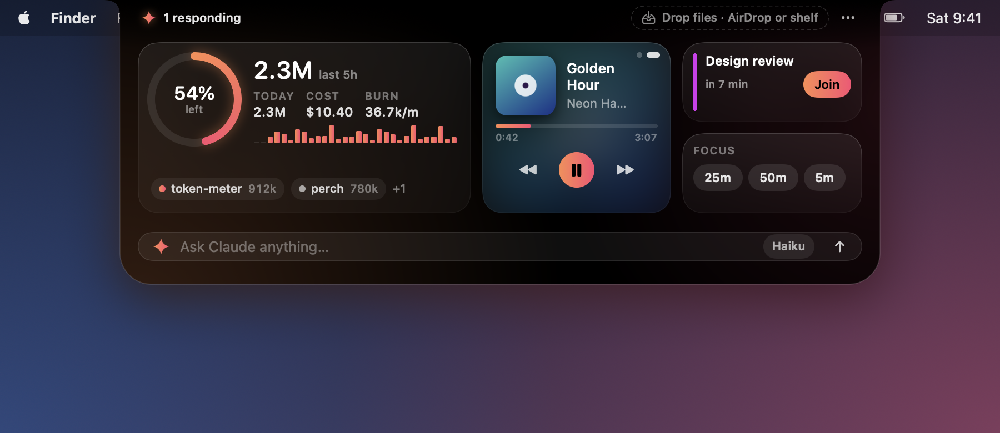
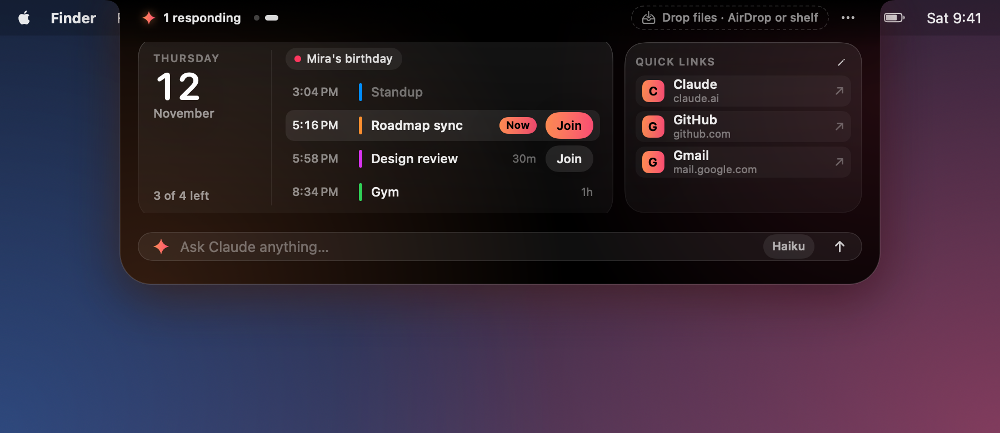
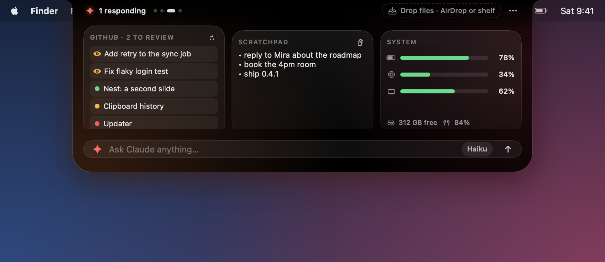
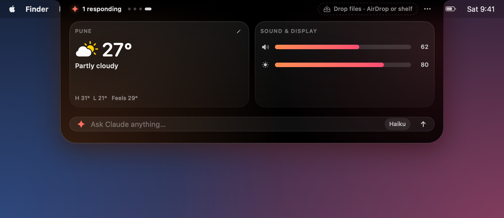
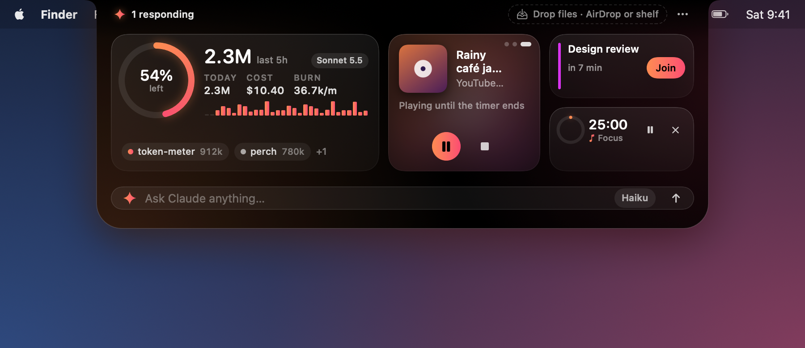
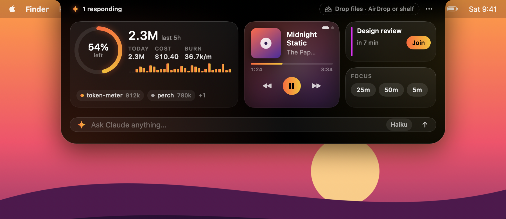
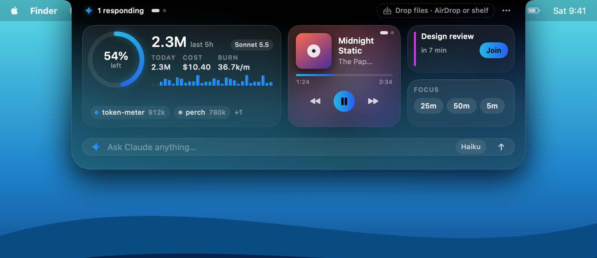
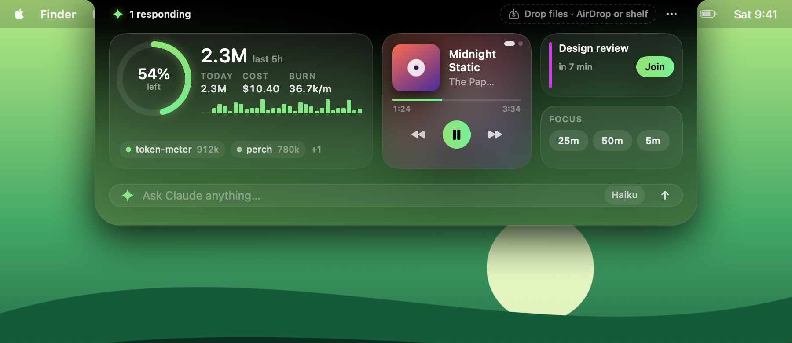
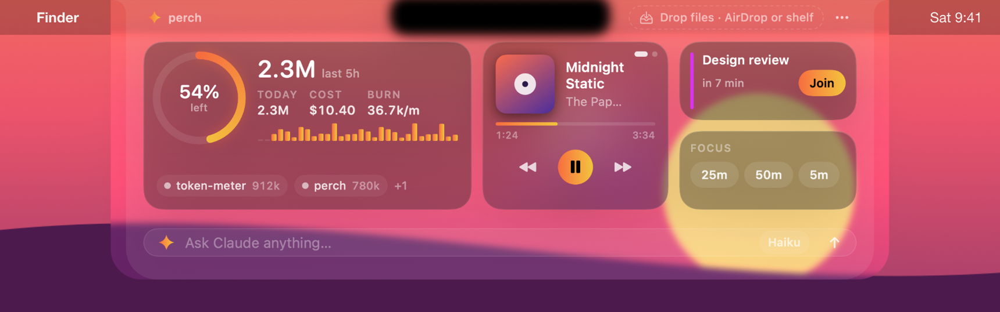

<p align="center"></p>

<h1 align="center">Perch</h1>

<p align="center"><i>Perched on your MacBook's notch, keeping an eye on Claude Code.</i></p>

<p align="center">
Your MacBook's notch, turned into a live Claude Code dashboard,<br>
a Spotify and Apple Music remote, an AirDrop and file shelf, a focus timer with its own music,<br>
your next meeting, a Nest of extra slides (today's calendar, quick links, clipboard history, GitHub, weather and more), and a one-line Claude prompt.
</p>

<p align="center"><a href="docs/media/perch.mp4"></a><br>
<sub>▶ <a href="docs/media/perch.mp4">Watch with sound</a> (25 s)</sub></p>

<p align="center"></p>

Perch sits in the notch and stays out of the way. Point at the notch and it springs open. While a Claude Code
session is responding, the notch glows softly so you can see it's working from any app.

## Features

### Claude Code at a glance
- Tokens for the **last 5 hours** and **today**, the estimated cost, and the **burn rate** with a 30-minute sparkline
- Your **all-sessions budget** as a ring, with how much is left
- Which sessions are **responding**, active or idle, by project folder
- The **model in use** (Sonnet 5.5, Opus 5.5, …): the responding session's, or the latest one's
- A soft **glow** around the notch while any session is responding, with the live token count beside the notch
- **Alerts slide out of the notch** at 80% and 100% of your budget, when the burn rate runs high, and (optionally) when a session finishes

<p align="center"></p>
<p align="center"></p>

These numbers come from [**token-meter**](https://github.com/tanmayhc7/claude-token-meter), a Claude Code plugin that
records each request's usage in `~/.claude/token-meter/`. Install it first. The model name is the one thing that comes
from elsewhere: the newest reply in the session's own transcript (see [Privacy](#privacy)).
Tokens are counted the way token-meter's budgets count them: cache reads weighted by their price.
Set a budget in Claude Code with `/token-budget all 5M` (or `/token-budget all $20`).

### Ask Claude from the notch
Type a question into the bar at the bottom and press Return. It runs `claude -p` with your own Claude Code login and
streams the answer into the notch. Pick **Haiku**, **Sonnet** or **Opus** from the chip; Haiku is the default because
it's the cheapest. The cost of each answer is shown next to it.

<p align="center"></p>

### Spotify and Apple Music
Track, artist, artwork and progress, with previous, play/pause and next. Spotify and Apple Music share one tile:
**swipe sideways with two fingers** (or click the dots in the corner) to switch, and the tile turns to whichever
app starts playing on its own. Perch never opens either app by itself; when one is closed its page shows an
**Open** button instead. Once you choose [focus music](#focus-timer), it gets a third page here.

<p align="center"></p>

### Drop zone: AirDrop and a shelf
As soon as you start dragging files anywhere, a hint slides out of the notch. Drag them onto the notch and it opens into two targets:
- **AirDrop** sends them to a nearby device.
- **Shelf** holds them in the notch so you can drag them out later, into any app. Right-click a file for Open, Show in Finder, AirDrop or Remove.

The shelf keeps references to your files. It never copies, moves or uploads them.

<p align="center"></p>
<p align="center"></p>
<p align="center"></p>

### Next meeting
Your next event in the next 24 hours, with a **Join** button for Zoom, Google Meet, Teams, Webex, FaceTime and other
video links. Two minutes before it starts, a reminder with Join slides out of the notch. Calendar access is only
requested when you click **Show my calendar**.

**Which calendars.** Perch reads every calendar on your Mac and shows the earliest event across all of them, so iCloud,
Google, Outlook and Exchange calendars combine into one "next meeting". Choose which count under **⋯ → Calendars**,
where they're grouped by account with a checkmark each; a calendar you add later is included until you turn it off.
To bring in Google Calendar, add your Google account in System Settings → Internet Accounts and switch on Calendars
(**⋯ → Calendars → Add a Google or other account…** opens it). Nothing goes through Google directly: events are read
on your Mac by macOS.

### Nest
The open notch has more slides, your **Nest**. **Swipe sideways with two fingers** anywhere on the notch except the music tile
(which turns its own pages), or click the dots next to "perch", to move between slides. You choose what's in the Nest
under **⋯ → Nest**. Widgets go three to a slide, and **a new slide appears by itself** when you switch on more than three.
Only today's calendar and quick links are on to start with; the rest wait until you switch them on.

- **Today's calendar**: everything on today from the calendars you've switched on. All-day events sit along the top,
  then the day in time order: the event on now is highlighted, earlier ones are dimmed, and video meetings get a
  **Join** button. It opens at what's on now; scroll up for the morning.
- **Quick links**: up to four links you open often (it starts with Claude, GitHub and Gmail). A click opens the link
  in your default browser. Change them with the pencil on the tile or **⋯ → Nest → Edit quick links…**.
- **Clipboard history**: the last ten things you copied as text, newest first; click one to copy it again. It lives in
  memory only, is emptied when you switch the widget off, and skips anything a password manager marks as secret.
- **GitHub**: pull requests waiting for your review, and your own open ones with a dot for their checks (green, amber,
  red). It reads them through the [GitHub CLI](https://cli.github.com) (`gh`) you're signed in with, and only while
  the notch is open. Click one to open it.
- **Scratchpad**: a small text area that saves as you type, kept on your Mac.
- **System glance**: battery, processor and memory load, free disk space, and the battery of a connected Bluetooth
  device such as AirPods. It updates every two seconds while the notch is open.
- **Weather**: the temperature, conditions and today's high and low for a city you type in (°F or °C by your region).
- **Volume & brightness**: two sliders for the output volume (click the speaker to mute) and the built-in display.
  Brightness uses a macOS system library with no public documentation, so it may stop working in a future macOS; the
  slider then simply disappears.

With one or two widgets on a slide, they share its width; the calendar always gets twice a quick-links tile's share.

<p align="center"></p>
<p align="center"></p>
<p align="center"></p>

### Focus timer
25, 50 or 5 minutes. The countdown ring sits beside the closed notch, and a chime plus a slide-out tell you when it's done.

**Do Not Disturb while it runs (optional).** Turn on **⋯ → Do Not Disturb during focus timer** and starting a timer
turns on Do Not Disturb; when it ends or you stop it, Perch turns it off and puts back the Focus you had on before
(Work, Personal, or none). If you switch Focus yourself during the timer, Perch leaves your choice alone.

macOS doesn't let apps change Focus directly, so this goes through two small shortcuts, **Perch Focus** and
**Perch Focus Off**. The first time you turn the option on, Perch opens them in the Shortcuts app; click
**Add Shortcut** on each. They only get and set your Focus, and you can read every step in Shortcuts.
Perch remembers a running session, so quitting Perch, a crash or sleep can't leave Do Not Disturb stuck on.

**Focus music (optional).** Under **⋯ → Focus music**, pick an audio file (mp3, m4a, wav, …) or paste a YouTube link
(a video or a live stream). It plays for as long as a 25 or 50 minute timer runs (a file loops), fading in when you
start or resume and out when you pause, stop or finish; breaks stay quiet. If Spotify or Apple Music is playing, Perch
pauses it first. The music gets its own page in the music tile, next to Spotify and Apple Music, where you can pause it
or stop it for the rest of the session while the timer keeps going.

YouTube needs a connection. If [Brave](https://brave.com) is installed, the video plays in a private, headless Brave
(its own profile, no window or Dock icon) whose Shields block YouTube's ads; otherwise it plays in a hidden web page
inside Perch, where ads still play (Perch presses Skip when YouTube offers it). The hidden page closes when the timer
ends, after two minutes paused (resuming reopens it where it was), and on its own if Perch quits unexpectedly.

<p align="center"></p>

### Themes
**Auto** (the default) takes its colours from your wallpaper, so the open notch blends into your desktop: it stays
black around the hardware notch and fades into the wallpaper's own colour toward its bottom edge, while the glow,
rings and buttons take the wallpaper's strongest colours, brightened to glow on black. It looks at the strip of wallpaper behind the menu bar,
and it follows you when you change wallpapers or switch to a Space with a different one. It reads the wallpaper file
only, so it needs no Screen Recording permission. For a dynamic or aerial wallpaper with no picture file, it uses
your Mac's accent colour.

<p align="center">



</p>

**Glass** goes further: the open notch is clear glass (Liquid Glass on macOS 26 and later), so you see your wallpaper
and windows through it, lightly blurred. Only the patch behind the camera stays black, the tiles are darker panes so
text and buttons stay readable, and the accents come from the wallpaper as in Auto. The closed notch stays black.
On earlier macOS it uses the system's blur instead.

<p align="center"></p>

Or pick a fixed theme from the **⋯** menu: **Ember** (above), **Aurora** or **Graphite**.

<p align="center">


</p>

Macs without a notch get a small pill at the top center of the screen that works the same way.

## Install

Open **Terminal** (press **Cmd + Space**, type `Terminal`, press Return), paste this one line, and press Return:

```bash
curl -fsSL https://raw.githubusercontent.com/tanmayhc7/perch/main/install.sh | bash
```

That's all: no Git, no Xcode, no password. Perch is installed in **Applications** and opens. When a newer version is out, Perch
tells you (a notice, and a dot beside **⋯**; you can turn this off in the menu). To update, click **Update** in the
notice or choose **⋯ → Update to Perch …** (or **Check for updates** at any time): Perch downloads the latest release,
checks it against GitHub's checksum, replaces itself and reopens. No Terminal needed. (Running the line above again
does the same.) An update can make macOS ask for Calendar access again, because each release is signed afresh.

The script ([install.sh](install.sh), about 100 lines, worth a read before you run it) finds the latest
[release](https://github.com/tanmayhc7/perch/releases/latest), downloads it, checks it against the checksum GitHub lists
for it, quits Perch if it's running, and copies `Perch.app` into `/Applications` (or `~/Applications` if that isn't
writable for you). Perch isn't notarized by Apple yet (see [Signing](#signing-and-notarization)), so macOS would
otherwise warn about an "unidentified developer": the script clears the "downloaded from the internet" flag on the app
to skip that warning. It never uses `sudo`.

Requires macOS 14 Sonoma or later. The app is a universal binary (Apple Silicon and Intel).

There's no Dock icon. To quit, open the notch and choose **⋯ → Quit Perch**.

### Permissions it asks for
| When | Permission | Why |
| --- | --- | --- |
| First time Spotify is open | Automation → Spotify | To read the current track and play, pause and skip |
| First time Apple Music is open | Automation → Music | The same, for Apple Music |
| You click **Show my calendar** | Calendars | To show your next meeting |
| You turn on **Do Not Disturb during focus timer** | Adding two shortcuts in Shortcuts | To turn Do Not Disturb on and off for the timer |

You can turn any of these off in **System Settings → Privacy & Security** at any time.

## Build from source

You need the Xcode **Command Line Tools** (`xcode-select --install`) with Swift 5.10 or later. The full Xcode app isn't needed.

```bash
git clone https://github.com/tanmayhc7/perch.git
cd perch
./scripts/build-app.sh          # → dist/Perch.app and dist/perch-<version>.zip
open dist/Perch.app
```

Other useful commands:

```bash
swift run LedgerCheck                          # checks for the ledger reader
swift run Perch --snapshot docs/images   # re-render the README screenshots from sample data
```

### Project layout
| Path | What's there |
| --- | --- |
| `Sources/LedgerKit` | Reads token-meter's ledger and computes the stats, plus the model name from a session's transcript. No UI code, so a menu-bar app or CLI can reuse it. |
| `Sources/Perch/NotchController.swift` | The borderless panel over the notch, hover and drag detection |
| `Sources/Perch/*Model*.swift` | Claude, music players, shelf, calendar, timer and prompt models; `AutoPalette.swift` picks the Auto theme's colours |
| `Sources/Perch/RootView.swift`, `ExpandedView.swift` | The SwiftUI views |
| `Sources/Perch/Slides.swift`, `NestWidgets.swift`, `WidgetModels.swift` | The Nest: slides, how widgets are paged three to a slide, each widget's view, and the models behind them |
| `Sources/Perch/Updater.swift` | Updates: the daily "update available" check, and the one-click download, checksum check and swap |
| `scripts/build-app.sh` | Builds a universal `.app` and the release zip with SwiftPM only |
| `scripts/focus-shortcut.py` | Generates and signs the two Focus shortcuts in `Resources/` |
| `Sources/Perch/FocusLink.swift` | Runs those shortcuts for the focus timer, with crash and sleep recovery |
| `Sources/Perch/FocusMusic.swift`, `YouTubeAudio.swift` | Focus music: the looping file player, and YouTube in a hidden Brave or web view |

## Privacy
- Everything stays on your Mac. Perch has no analytics, no telemetry and no server.
- It reads `~/.claude/token-meter/` (written by token-meter) for usage. To show which model is in use, it also opens the
  last part of the current session's transcript in `~/.claude/projects/` and takes one thing from it: the model name on
  the newest reply. Your conversation isn't displayed, kept or sent anywhere.
- Questions you type into the notch are sent to Anthropic by your own `claude` command, exactly as if you ran `claude -p` in Terminal, and they use your Claude Code plan or API credits.
- Spotify artwork is downloaded from Spotify's image servers. Nothing is sent to Spotify beyond what its own app already does. Apple Music artwork comes straight from the Music app.
- The Auto theme reads your wallpaper file on your Mac to pick colours. It doesn't capture your screen. If your wallpaper is in Desktop, Documents or Downloads, it's only read after you choose **Auto** in the menu yourself, because macOS asks permission for those folders.
- Calendar events are read on your Mac with Apple's EventKit and never leave it.
- YouTube focus music loads youtube.com in a hidden page, like opening the video in a browser; nothing else is sent. With
  Brave, that page runs in a private Brave profile of Perch's own, controlled through a debugging port that only your
  Mac can reach (127.0.0.1) while the music plays.
- The Focus option runs the two Perch shortcuts on your Mac with Apple's `shortcuts` command. They read and set your Focus and nothing else.
- Nest widgets only run once you switch them on. **Clipboard history** watches what you copy (text only, in memory, never saved or sent). **GitHub** runs your own `gh` command to ask GitHub for your pull requests. **Weather** sends the city you typed, then its coordinates, to open-meteo.com. The others read from your Mac.
- **Updates.** Once a day, Perch asks GitHub (api.github.com) whether a newer release exists, and tells you with a notice and a dot beside **⋯**. That request carries no personal data, and Perch never installs anything by itself: the download only starts when you click **Update**. Turn it off with **⋯ → Tell me when an update is out**; **Check for updates** then still works whenever you click it.
- Files on the shelf are only referenced, never copied or uploaded. AirDrop uses macOS's own AirDrop sheet.

## Signing and notarization
Releases are currently **ad-hoc signed and not notarized**, which is why [the install script](#install) clears the quarantine flag (without it, macOS makes you approve the app once in System Settings → Privacy & Security).
Notarizing needs a paid Apple Developer account. When one is available, the release steps become:

1. Sign with a Developer ID certificate and the hardened runtime:
   `codesign --force --options runtime --timestamp --sign "Developer ID Application: <Name> (<TEAMID>)" dist/Perch.app`
2. Zip and submit for notarization:
   `ditto -c -k --keepParent dist/Perch.app perch.zip`
   `xcrun notarytool submit perch.zip --apple-id <id> --team-id <TEAMID> --password <app-specific-password> --wait`
3. Staple the ticket and re-zip: `xcrun stapler staple dist/Perch.app`

`notarytool` and `stapler` ship with Xcode, so this step needs Xcode or a CI runner that has it.

## Roadmap
- A menu-bar version of the Claude stats (sharing `LedgerKit`)
- An estimate of claude.ai chat usage next to Claude Code's
- Signed and notarized releases, and Homebrew

## Credits
Made by [@tanmayhc7](https://github.com/tanmayhc7). Perch is an independent project and isn't affiliated with or
endorsed by Anthropic, Spotify or Apple. Copyright © 2026 Tanmay Chandavarkar. Released under the [GNU Affero General Public License v3.0](LICENSE) (AGPL-3.0): you can use, change and share it, but if you distribute a modified version, or run one for others over a network, you must publish its source under the same license.
