<p align="center">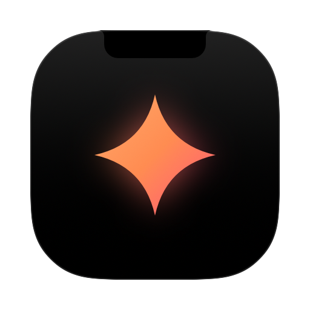</p>

<h1 align="center">Perch</h1>

<p align="center"><i>Perched on your MacBook's notch, keeping an eye on Claude Code.</i></p>

<p align="center">
Your MacBook's notch, turned into a live Claude Code dashboard,<br>
a Spotify remote, an AirDrop and file shelf, and a one-line Claude prompt.
</p>

<p align="center"><a href="docs/media/perch.mp4">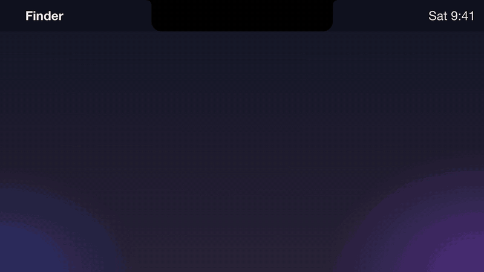</a><br>
<sub>▶ <a href="docs/media/perch.mp4">Watch with sound</a> (23 s)</sub></p>

<p align="center">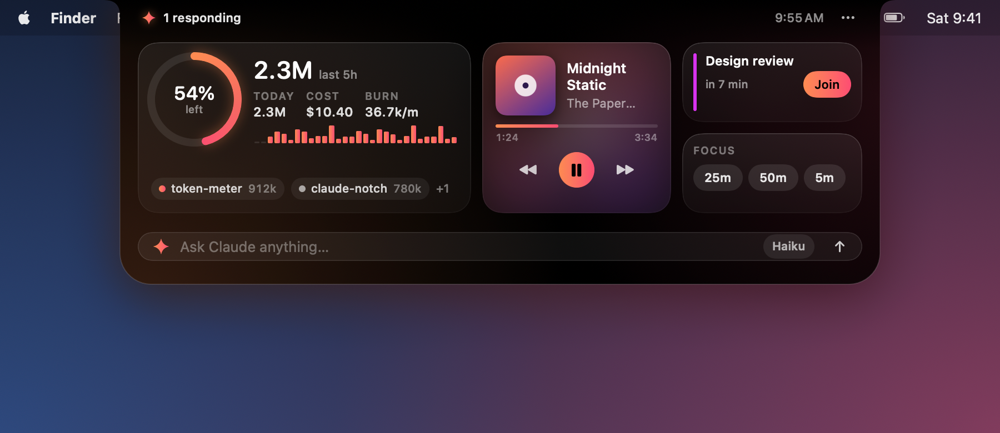</p>

Perch sits in the notch and stays out of the way. Point at the notch and it springs open. While a Claude Code
session is responding, the notch glows softly so you can see it's working from any app.

## Features

### Claude Code at a glance
- Tokens for the **last 5 hours** and **today**, the estimated cost, and the **burn rate** with a 30-minute sparkline
- Your **all-sessions budget** as a ring, with how much is left
- Which sessions are **responding**, active or idle, by project folder
- A soft **glow** around the notch while any session is responding, with the live token count beside the notch
- **Alerts slide out of the notch** at 80% and 100% of your budget, when the burn rate runs high, and (optionally) when a session finishes

<p align="center">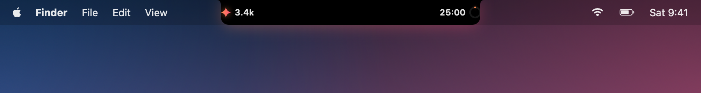</p>
<p align="center">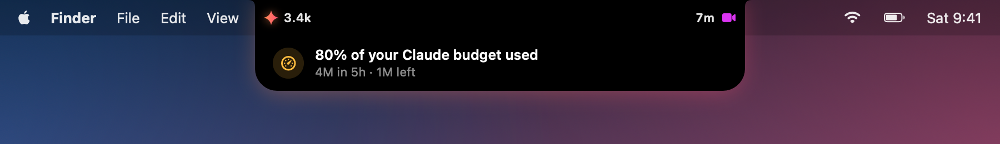</p>

These numbers come from [**token-meter**](https://github.com/tanmayhc7/claude-token-meter), a Claude Code plugin that
records each request's usage in `~/.claude/token-meter/`. Install it first; Perch only reads that folder.
Tokens are counted the way token-meter's budgets count them: cache reads weighted by their price.
Set a budget in Claude Code with `/token-budget all 5M` (or `/token-budget all $20`).

### Ask Claude from the notch
Type a question into the bar at the bottom and press Return. It runs `claude -p` with your own Claude Code login and
streams the answer into the notch. Pick **Haiku**, **Sonnet** or **Opus** from the chip; Haiku is the default because
it's the cheapest. The cost of each answer is shown next to it.

<p align="center">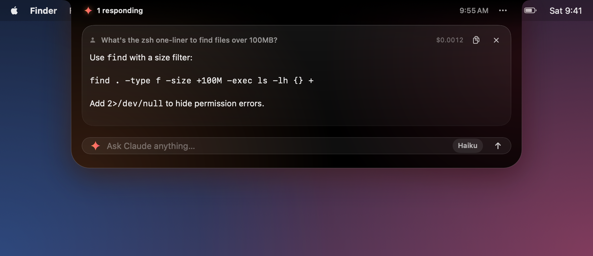</p>

### Spotify
Track, artist, artwork and progress, with previous, play/pause and next. Perch never opens Spotify by itself;
when Spotify is closed it shows an **Open Spotify** button instead.

### Drop zone: AirDrop and a shelf
As soon as you start dragging files anywhere, a hint slides out of the notch. Drag them onto the notch and it opens into two targets:
- **AirDrop** sends them to a nearby device.
- **Shelf** holds them in the notch so you can drag them out later, into any app. Right-click a file for Open, Show in Finder, AirDrop or Remove.

The shelf keeps references to your files. It never copies, moves or uploads them.

<p align="center">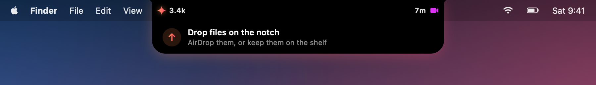</p>
<p align="center">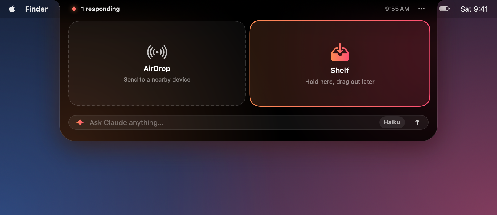</p>
<p align="center">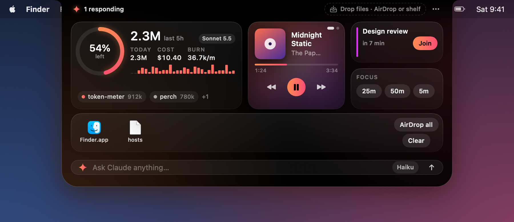</p>

### Next meeting
Your next event in the next 24 hours, with a **Join** button for Zoom, Google Meet, Teams, Webex, FaceTime and other
video links. Two minutes before it starts, a reminder with Join slides out of the notch. Calendar access is only
requested when you click **Show my calendar**.

### Focus timer
25, 50 or 5 minutes. The countdown ring sits beside the closed notch, and a chime plus a slide-out tell you when it's done.

### Themes
Three themes from the **⋯** menu: **Ember** (above), **Aurora** and **Graphite**.

<p align="center">
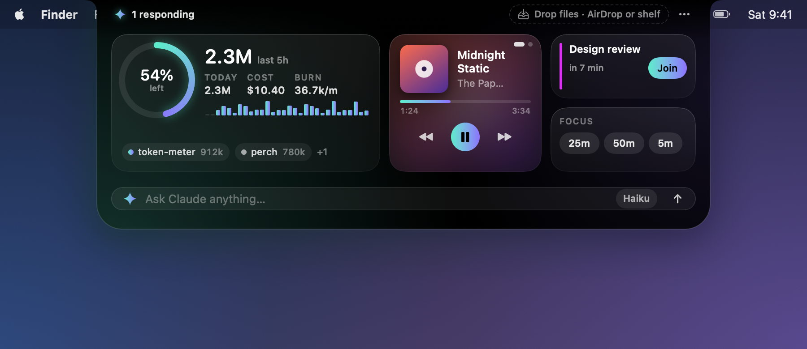
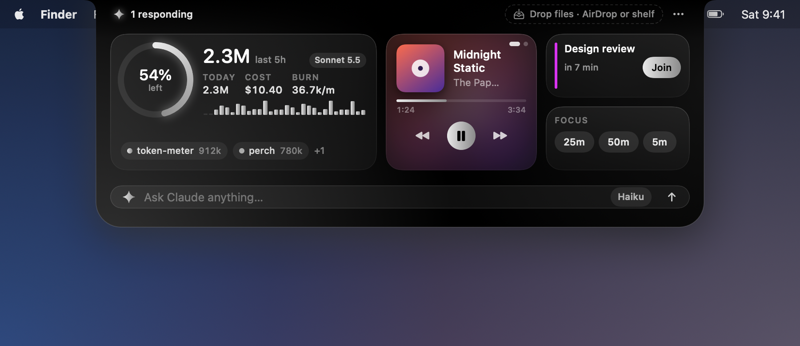
</p>

Macs without a notch get a small pill at the top center of the screen that works the same way.

## Install

1. Download `perch-<version>.zip` from the [latest release](https://github.com/tanmayhc7/perch/releases/latest) and unzip it.
2. Drag **Perch.app** into **Applications**.
3. Open it. macOS blocks it the first time, because the app isn't notarized by Apple yet (see [Signing](#signing-and-notarization)):
   - Click **Done** on the warning.
   - Open **System Settings → Privacy & Security**, scroll down to the message about Perch, and click **Open Anyway**.
   - Confirm with **Open Anyway** and your password.

   You only need to do this once. If you'd rather use Terminal: `xattr -dr com.apple.quarantine /Applications/Perch.app`
4. Point at the notch. To start it with your Mac, turn on **Open at login** in the **⋯** menu.

Requires macOS 14 Sonoma or later. The app is a universal binary (Apple Silicon and Intel).

There's no Dock icon. To quit, open the notch and choose **⋯ → Quit Perch**.

### Permissions it asks for
| When | Permission | Why |
| --- | --- | --- |
| First time Spotify is open | Automation → Spotify | To read the current track and play, pause and skip |
| You click **Show my calendar** | Calendars | To show your next meeting |

You can turn either off in **System Settings → Privacy & Security** at any time.

## Build from source

You need the Xcode **Command Line Tools** (`xcode-select --install`) with Swift 5.10 or later. The full Xcode app isn't needed.

```bash
git clone https://github.com/tanmayhc7/perch.git
cd perch
./scripts/build-app.sh          # → dist/Perch.app and dist/perch-<version>.zip
open dist/Perch.app
```

Other useful commands:

```bash
swift run LedgerCheck                          # checks for the ledger reader
swift run Perch --snapshot docs/images   # re-render the README screenshots from sample data
```

### Project layout
| Path | What's there |
| --- | --- |
| `Sources/LedgerKit` | Reads token-meter's ledger and computes the stats. No UI code, so a menu-bar app or CLI can reuse it. |
| `Sources/Perch/NotchController.swift` | The borderless panel over the notch, hover and drag detection |
| `Sources/Perch/*Model*.swift` | Claude, Spotify, shelf, calendar, timer and prompt models |
| `Sources/Perch/RootView.swift`, `ExpandedView.swift` | The SwiftUI views |
| `scripts/build-app.sh` | Builds a universal `.app` and the release zip with SwiftPM only |

## Privacy
- Everything stays on your Mac. Perch has no analytics, no telemetry and no server.
- It reads `~/.claude/token-meter/` (written by token-meter). It never reads your Claude Code conversations.
- Questions you type into the notch are sent to Anthropic by your own `claude` command, exactly as if you ran `claude -p` in Terminal, and they use your Claude Code plan or API credits.
- Spotify artwork is downloaded from Spotify's image servers. Nothing is sent to Spotify beyond what its own app already does.
- Calendar events are read on your Mac with Apple's EventKit and never leave it.
- Files on the shelf are only referenced, never copied or uploaded. AirDrop uses macOS's own AirDrop sheet.

## Signing and notarization
Releases are currently **ad-hoc signed and not notarized**, which is why macOS asks you to approve the app once.
Notarizing needs a paid Apple Developer account. When one is available, the release steps become:

1. Sign with a Developer ID certificate and the hardened runtime:
   `codesign --force --options runtime --timestamp --sign "Developer ID Application: <Name> (<TEAMID>)" dist/Perch.app`
2. Zip and submit for notarization:
   `ditto -c -k --keepParent dist/Perch.app perch.zip`
   `xcrun notarytool submit perch.zip --apple-id <id> --team-id <TEAMID> --password <app-specific-password> --wait`
3. Staple the ticket and re-zip: `xcrun stapler staple dist/Perch.app`

`notarytool` and `stapler` ship with Xcode, so this step needs Xcode or a CI runner that has it.

## Roadmap
- A menu-bar version of the Claude stats (sharing `LedgerKit`)
- An estimate of claude.ai chat usage next to Claude Code's
- Signed and notarized releases, and Homebrew

## Credits
Made by [@tanmayhc7](https://github.com/tanmayhc7). Perch is an independent project and isn't affiliated with or
endorsed by Anthropic or Spotify. Copyright © 2026 Tanmay Chandavarkar. Released under the [GNU Affero General Public License v3.0](LICENSE) (AGPL-3.0): you can use, change and share it, but if you distribute a modified version, or run one for others over a network, you must publish its source under the same license.
