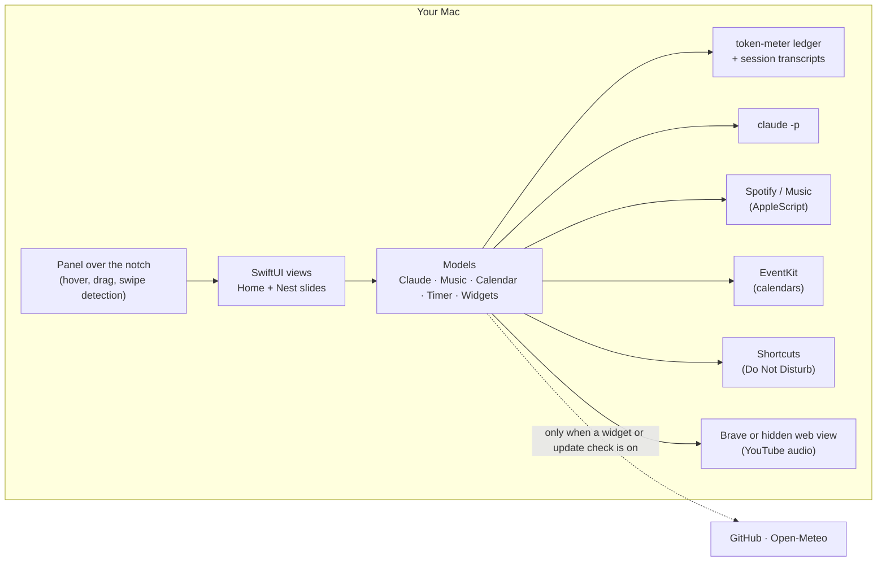

# How Perch works

The technical side of [Perch](../README.md): where each feature gets its data, what Perch runs on your Mac,
what it asks permission for, and how to build and change it. If you only want to use the app, the README is enough.

- [The big picture](#the-big-picture)
- [Where each feature gets its data](#where-each-feature-gets-its-data)
- [Feature details](#feature-details)
- [Permissions](#permissions)
- [Privacy](#privacy)
- [Install script and updates](#install-script-and-updates)
- [Signing and notarization](#signing-and-notarization)
- [Build from source](#build-from-source)
- [Project layout](#project-layout)
- [Developer tools](#developer-tools)
- [Roadmap](#roadmap)

## The big picture

Perch is a native macOS app written in Swift (SwiftPM only, no Xcode project). It is one borderless, non-activating
`NSPanel` that sits over the notch; everything inside it is SwiftUI, driven by `@Observable` models.



- The panel sits at `.statusBar + 1`, ignores mouse events everywhere except over the notch, and opens from global
  mouse-moved monitors (and a drag poll for file drags).
- Models are created once in `AppEnvironment` (`AppDelegate.swift`) and injected into the views.
- Nothing runs while the notch is closed except the Claude stats refresh, the clipboard watcher (if that widget is on),
  and the once-a-day update check.

## Where each feature gets its data

| Feature | Source | Runs when |
| --- | --- | --- |
| Claude tokens, cost, burn, budget | token-meter's ledger in `~/.claude/token-meter/` | Every few seconds (every second while a session is responding); cheap file reads |
| Model in use | Tail of the session transcript in `~/.claude/projects/` | With each stats refresh |
| Ask Claude | Your own `claude` command (`claude -p`) | When you press Return |
| Spotify and Apple Music | AppleScript, plus the apps' own track-change notifications | While the app is running |
| AirDrop and shelf | `NSSharingService` (AirDrop sheet); the shelf stores file references | When you drop files |
| Next meeting, Today's calendar | EventKit (the Calendar database on your Mac) | Every 30 s and on change |
| Focus timer, Do Not Disturb | Two signed Shortcuts, run with the `shortcuts` command | When a timer starts or ends |
| Focus music | `AVAudioPlayer` (files); a hidden Brave or web view (YouTube) | While a focus timer runs |
| Auto and Glass themes | The wallpaper file (`NSWorkspace.desktopImageURL`) | When the wallpaper changes |
| Nest: clipboard, GitHub, scratchpad, system, weather, sound and brightness | See [Nest widgets](#nest-widgets) | Only once a widget is switched on |
| Update notice | GitHub's releases API | Once a day, if allowed |

## Feature details

### Claude Code at a glance
`LedgerKit` (no UI code, so a menu-bar app or CLI could reuse it) reads the files the
[token-meter](https://github.com/tanmayhc7/claude-token-meter) plugin writes: one JSON file per session and a
`budget.json`. From them it computes:

- tokens in the budget window (5 hours by default) and today, counting cache reads the way token-meter's budgets do
  (weighted by price), the estimated cost, and the burn rate with a 30-minute sparkline;
- which sessions are responding, active or idle;
- the share of the all-sessions budget used. Set one in Claude Code with `/token-budget all 5M` (or `all $20`).

The **model name** is the one thing that comes from elsewhere: Perch opens the last part of the current session's
transcript (`~/.claude/projects/*/<sessionId>.jsonl`) and takes the `message.model` of the newest assistant reply. It
doesn't keep or show anything else from it. Results are cached per transcript.

The glow around the notch, the live token count beside it, and the alerts (80% and 100% of budget, high burn rate,
optionally a finished session) all come from the same stats.

### Ask Claude from the notch
Pressing Return runs, in your home folder:

```
claude -p --model <haiku|sonnet|opus> --output-format stream-json --verbose --include-partial-messages
```

- The question goes in on **stdin**, never as an argument, so typing `--help` into the notch is a question, not a flag.
- `PATH` is extended with `/opt/homebrew/bin`, `/usr/local/bin` and `~/.local/bin`, because apps don't inherit your
  shell's `PATH`.
- Answers stream in as `text_delta` events; the final `result` event carries the cost shown next to the answer.
- It uses your own Claude Code login and plan, so Perch holds no key and talks to no server of its own.
- Cancelling terminates the process, and each run reads only into its own state, so a cancelled run's last bytes can't
  land in the next answer.

### Spotify and Apple Music
`PlayerModel` talks to each app with AppleScript (`NSAppleScript`), listens to their distributed notifications for
track changes, and checks every 5 seconds while the app is running. Perch never launches either app; a closed app shows an
**Open** button. Spotify artwork is fetched from Spotify's image URL; Apple Music's comes from the Music app.
The two share one tile (a horizontal paging scroll view); the focus music adds a third page.

### Drop zone and shelf
While files are dragged anywhere, a hint slides out of the notch; dropping on the notch shows the targets. **AirDrop**
uses `NSSharingService(named: .sendViaAirDrop)`. The **shelf** only keeps references to your files (never copies or
uploads them) and prunes ones that no longer exist.

### Calendar
EventKit, with access requested only when you click **Show my calendar**. Perch reads every calendar on the Mac (iCloud,
Google, Exchange… as added in System Settings → Internet Accounts), minus the ones you switch off under
**⋯ → Calendars** (stored as a list of *hidden* calendar ids, so a calendar added later is included). The next meeting
is the earliest non-declined event in the next 24 hours; the join link is found by a regular expression over the
event's URL, location and notes (Zoom, Meet, Teams, Webex, FaceTime…).

### Focus timer and Do Not Disturb
macOS has no public API to change Focus, so Perch ships two small signed shortcuts (`Resources/Perch Focus.shortcut` and
`Perch Focus Off.shortcut`, generated by `scripts/focus-shortcut.py` with `shortcuts sign --mode anyone`; they carry no
personal details). `FocusLink` runs them with `shortcuts run`, remembers which Focus was on before so it can put it
back, and persists a running session so a quit, crash or sleep can't leave Do Not Disturb stuck on.

### Focus music
- **Files** play through `AVAudioPlayer`, looping, with fades in and out.
- **YouTube** plays in a hidden browser. If [Brave](https://brave.com) is installed, `BravePage` starts it headless with
  its own profile (`Application Support/Perch/Brave`) and `--remote-debugging-port=0`, finds the port in
  `DevToolsActivePort`, and drives the page over a WebSocket (Chrome DevTools Protocol, `Runtime.evaluate` with a user
  gesture). Brave's Shields block YouTube's ads. The debugging port listens on `127.0.0.1` only. Otherwise `WebKitPage`
  uses an off-screen `WKWebView`, where ads play and Perch presses Skip when it appears.
- Swift drives `play()` and the volume (every second, and at 20 Hz during fades), because timers in a hidden page are
  throttled. The page pauses itself if it hears nothing from Perch for 10 s; a 25 s watchdog gives up on a start that
  never plays; a page paused for two minutes is closed (resuming reopens it where it was).
- Cleanup has three layers so no browser is left behind: a watcher shell that kills Brave when Perch's process
  disappears, a sweep at launch, and closing on timer end.

### Themes
- **Auto** reads the wallpaper *file* (no screen capture, so no Screen Recording permission), samples the strip behind
  the menu bar for the accent colours and the area below the open notch for the surface colour, and re-reads when the
  wallpaper or Space changes. A dynamic or aerial wallpaper with no picture file falls back to the system accent colour.
- **Glass** uses `glassEffect(.clear, in:)` (Liquid Glass) on macOS 26 and later, and `NSVisualEffectView`
  (`.behindWindow`) before that. Tiles are darker panes on the glass; after a click inside the notch they turn solid
  (`NotchState.engaged`) so they stay readable on any background. The panel uses `becomesKeyOnlyIfNeeded`, because a
  focused window draws Liquid Glass clearer; only the Ask field and the Scratchpad take keyboard focus.
- A Mac without a notch gets a small pill at the top centre that behaves the same way.

### Slides and the Nest
- Two fingers sideways switch slides. A local `NSEvent` scroll-wheel monitor accumulates the gesture's horizontal
  movement (following the fingers whichever way natural scrolling is set), switches once it passes 45 points and is
  clearly horizontal, and does nothing for a swipe that starts over the music tile (which pages by itself).
- The slides are laid side by side and slid with an offset animation. **Home** is fixed. The Nest holds the widgets you
  switch on, **three to a slide**: `AppSettings.pages` splits them in the order of the `Widget` enum, so a new slide
  exists exactly when there are more than three. Widths are shared by weight (the calendar counts twice).
- Widget choices are stored as an *enabled* list, so every widget added in future starts off.

### Nest widgets
Each does nothing until switched on, and the polling ones run only while the notch is open.

| Widget | How it works |
| --- | --- |
| Today's calendar | The same EventKit store as the next meeting, for the whole day; scrolls to what's on now |
| Quick links | A list of up to four `{title, url}` saved in preferences; opens with `NSWorkspace` |
| Clipboard history | Polls `NSPasteboard.changeCount` once a second; keeps ten plain-text items **in memory only** (never written to disk); skips copies tagged `org.nspasteboard.ConcealedType`, `TransientType`, `AutoGeneratedType` or by 1Password; cleared when the widget is switched off |
| GitHub | One `gh api graphql` call: your open PRs with their `statusCheckRollup` state, plus a search for PRs waiting for your review. Uses the `gh` you're signed in with (found in `/opt/homebrew/bin`, `/usr/local/bin`, `~/.local/bin`, `/usr/bin`); refreshes at most every 90 s; killed after 25 s |
| Scratchpad | A `TextEditor` saved to preferences as you type (20,000 characters at most) |
| System glance | `IOPSCopyPowerSourcesInfo` (battery), `host_statistics` (CPU ticks), `host_statistics64` and the `kern.memorystatus_vm_pressure_level` sysctl (memory), the volume's available capacity (disk), and `system_profiler -json SPBluetoothDataType` every two minutes for AirPods and other devices; sampled every 2 s |
| Weather | [Open-Meteo](https://open-meteo.com): the city you type is looked up once (geocoding), then the forecast for its coordinates is fetched at most every 30 minutes; °F or °C by your region |
| Volume & brightness | Core Audio (`'vmvc'`, the virtual main volume the volume keys use, and `kAudioDevicePropertyMute`); brightness through the private `DisplayServices` library, looked up with `dlopen`/`dlsym` at run time. If that is missing the slider is hidden |

## Permissions

| When | Permission | Why |
| --- | --- | --- |
| First time Spotify is open | Automation → Spotify | To read the current track and play, pause and skip |
| First time Apple Music is open | Automation → Music | The same, for Apple Music |
| You click **Show my calendar** | Calendars | To show your next meeting and today's agenda |
| You turn on **Do Not Disturb during focus timer** | Adding two shortcuts in Shortcuts | To turn Do Not Disturb on and off for the timer |
| Your wallpaper is in Desktop, Documents or Downloads, and you choose **Auto** | Files and Folders | To read the wallpaper file to pick colours |

You can turn any of these off in **System Settings → Privacy & Security**. An update can make macOS ask for Calendar
access again, because each release is signed afresh.

## Privacy

- Everything stays on your Mac. Perch has no analytics, no telemetry and no server of its own.
- It reads `~/.claude/token-meter/` for usage, and the model name from the tail of the current session's transcript.
  Your conversation isn't displayed, kept or sent anywhere.
- Questions typed into the notch are sent to Anthropic by your own `claude` command, exactly as if you ran `claude -p`
  in Terminal, and use your Claude Code plan or API credits.
- Spotify artwork is downloaded from Spotify's image servers; nothing is sent to Spotify beyond what its own app does.
- The Auto theme reads your wallpaper file; it never captures the screen.
- Calendar events are read on your Mac with EventKit and never leave it.
- YouTube focus music loads youtube.com in a hidden page, like opening the video in a browser; nothing else is sent.
- The Focus option runs the two Perch shortcuts with Apple's `shortcuts` command; they read and set your Focus only.
- Nest widgets run only once switched on. **Clipboard history** is text, in memory, never saved or sent. **GitHub** runs
  your own `gh`. **Weather** sends the typed city, then its coordinates, to open-meteo.com.
- **Updates:** once a day Perch asks GitHub (`api.github.com`) for the latest release; no personal data is in the
  request. It never installs anything without a click. Turn the check off under **⋯ → Tell me when an update is out**.
- Files on the shelf are only referenced, never copied or uploaded.

## Install script and updates

**`install.sh`** (about 100 lines; read it before you run it) does, in order:

1. checks for macOS 14 or later;
2. finds the latest release (the redirect of `/releases/latest`) and downloads `perch-<version>.zip`;
3. checks it against the SHA-256 GitHub lists for that asset (skipped, with a note, if the API can't be reached);
4. quits a running Perch from the install folder, then copies `Perch.app` into `/Applications` (or `~/Applications` if
   that isn't writable) with `ditto`;
5. clears the `com.apple.quarantine` flag, because releases aren't notarized yet, and opens the app.

It never uses `sudo`. For testing, `PERCH_INSTALL_DIR=<folder>` installs elsewhere and `PERCH_NO_OPEN=1` doesn't launch.

**In-app updates** (`Updater.swift`) follow the same steps without a shell script: fetch `releases/latest`, compare the
version, download the asset (HTTPS from `github.com` only), verify the SHA-256 from the release's asset digest and that
the app inside has Perch's bundle identifier, then hand a small shell the swap: it waits for Perch to quit, moves the old
app aside, copies the new one in (restoring the old one if the copy fails), clears quarantine, reopens it and removes
the temp folder. The daily check only sets "an update is available"; it never starts the download.

## Signing and notarization

Releases are **ad-hoc signed and not notarized**, which is why the install script clears the quarantine flag. Notarizing
needs a paid Apple Developer account. With one, the release steps become:

1. Sign with a Developer ID certificate and the hardened runtime:
   `codesign --force --options runtime --timestamp --sign "Developer ID Application: <Name> (<TEAMID>)" dist/Perch.app`
2. Zip and submit:
   `ditto -c -k --keepParent dist/Perch.app perch.zip`
   `xcrun notarytool submit perch.zip --apple-id <id> --team-id <TEAMID> --password <app-specific-password> --wait`
3. Staple and re-zip: `xcrun stapler staple dist/Perch.app`

`notarytool` and `stapler` ship with Xcode, so this needs Xcode or a CI runner that has it.

## Build from source

You need the Xcode **Command Line Tools** (`xcode-select --install`) with Swift 5.10 or later. The full Xcode app isn't
needed.

```bash
git clone https://github.com/tanmayhc7/perch.git
cd perch
./scripts/build-app.sh          # → dist/Perch.app and dist/perch-<version>.zip
open dist/Perch.app
```

`build-app.sh` builds arm64 and x86_64 slices, joins them with `lipo`, assembles the bundle outside the repo (a folder
synced by iCloud can make `codesign` refuse it), draws the icon with the app itself (`Perch --icon`) and signs ad hoc.
Set `VERSION=x.y.z` to override the version taken from the latest git tag.

## Project layout

| Path | What's there |
| --- | --- |
| `Sources/LedgerKit` | Reads token-meter's ledger, computes the stats, and finds the model name in a transcript. No UI code. |
| `Sources/LedgerCheck` | Checks for the ledger reader: `swift run LedgerCheck` |
| `Sources/Perch/NotchController.swift` | The panel over the notch, hover, drag and swipe detection, debug hooks |
| `Sources/Perch/RootView.swift`, `ExpandedView.swift`, `Components.swift` | The SwiftUI views and shared pieces |
| `Sources/Perch/Slides.swift`, `NestWidgets.swift`, `WidgetModels.swift` | The slides, the Nest's paging, each widget's view, and the models behind them |
| `Sources/Perch/ClaudeModel.swift`, `PromptModel.swift` | The Claude stats and Ask Claude |
| `Sources/Perch/PlayerModel.swift`, `FocusMusic.swift`, `YouTubeAudio.swift` | Music players; focus music and the hidden YouTube page |
| `Sources/Perch/Models.swift`, `FocusLink.swift` | Shelf, calendar, timer; the Do Not Disturb shortcuts |
| `Sources/Perch/AutoPalette.swift`, `NotchState.swift`, `NotchShape.swift` | Theme colours, settings and state, the notch's shape and sizes |
| `Sources/Perch/Updater.swift` | The update check and one-click update |
| `Sources/Perch/Snapshots.swift` | Renders the README screenshots and the video's frames from sample data |
| `scripts/build-app.sh`, `scripts/focus-shortcut.py`, `scripts/debug.sh` | Build, generate the shortcuts, drive a debug build |
| `install.sh` | The one-line installer |

## Developer tools

```bash
swift run LedgerCheck                              # checks for the ledger reader
swift run Perch --snapshot docs/images             # re-render the README screenshots from sample data
swift run Perch --snapshot-bare <dir>              # the notch alone on a transparent background (for videos)
PERCH_DEBUG=1 open dist/Perch.app                  # then:
./scripts/debug.sh expand | collapse | toast | drop | slide:next | widget:github:on | shot:/tmp/notch.png
```

With `PERCH_DEBUG=1`, a debug build listens for distributed notifications named `perch.debug` (that is what
`scripts/debug.sh` sends) to open and close the notch, move between slides, switch widgets, feed it a question, and save
a screenshot of the panel, all without Screen Recording permission. Output that macOS would redact from the log is
written to the file named in `PERCH_DEBUG_LOG`.

The launch video in `docs/media/` is built from `--snapshot-bare` frames composed in a web page and captured with
headless Chrome, with a score generated in Python.

## Roadmap

- A menu-bar version of the Claude stats (sharing `LedgerKit`)
- An estimate of claude.ai chat usage next to Claude Code's
- Signed and notarized releases, and Homebrew
